<p align="center">
  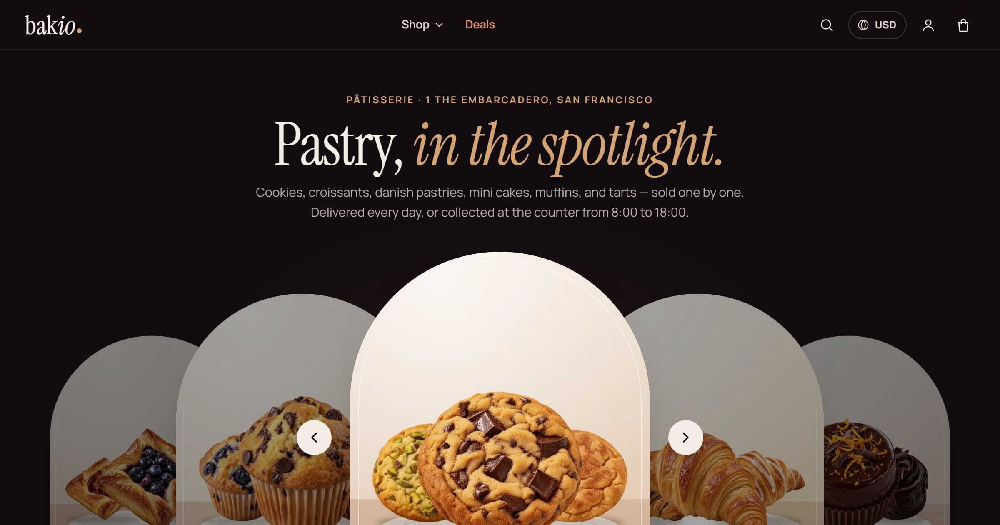
</p>

<h1 align="center">Bakini Noir Patisserie</h1>

<p align="center">
  <b>A single bakery as a dark pastry theatre: one pastry under a spotlight, deep caramel, gold and ivory.</b><br>
  A custom Selldone Layout built on the official <a href="https://github.com/selldone/storefront">selldone/storefront</a>.
</p>

<p align="center">
  <a href="https://bakini.selldone.shop"></a>
  <a href="https://github.com/selldone-custom-layouts/official-bakini/wiki"></a>
  <a href="https://github.com/selldone-custom-layouts/official-bakini/wiki/Install-with-AI"></a>
  
  
  
</p>

<p align="center">
  <a href="https://bakini.selldone.shop"><b>Open the live shop</b></a> ·
  <a href="https://github.com/selldone-custom-layouts/official-bakini/wiki/Install-with-AI">Set it up with AI</a> ·
  <a href="https://github.com/selldone-custom-layouts/official-bakini/wiki/Manual-Setup">Manual setup</a> ·
  <a href="https://github.com/selldone-custom-layouts/official-bakini/wiki/Shop-Requirements">What your shop needs</a> ·
  <a href="https://github.com/selldone-custom-layouts">All Selldone custom layouts</a>
</p>

---

## What it is

**Bakini Noir Patisserie** dresses a single pâtisserie as a dark pastry theatre, in the manner of a premium product launch: a pastry floating huge under a spotlight, the collections as tall dark cards, the shop's real facts in a bento, and a calm, glassy buy flow. It was drawn for **Bakio**, a bakery that sells individual pastries for courier delivery, worldwide shipping and pickup, paid in cash on delivery.

- a deep stage (`#120c10`) with ivory type, dark cards and a warm halo behind every pastry; each collection gets its own warm hue, in the shop's order;
- **one** deep caramel `#a0522d` for every action (buttons, chosen states, links), gold `#d4a373` for small type, savings and hairlines only;
- Instrument Serif (display, italic accents) over Manrope, and inline line icons;
- pastries as transparent cut-outs on dark plates, filling most of the plate;
- flat buttons, hover changes the colour only, no line under any word or icon, selection rings inside the box;
- dark by default, with an ivory light mode; a **Theme** row in the footer on the showcase shop: five palettes (Caramel, Cassis, Pistachio, Sapphire, Gold-safe), a **Custom colour** and Light / Dark;
- it says **bag**, never cart; every word it writes is in English and Arabic (right to left).

It runs on **[bakini.selldone.shop](https://bakini.selldone.shop)**, one address of the Selldone shop Bakio. Selldone lets each domain of a shop carry its own Layout.

Everything is read live from the shop: its title (drawn as the wordmark), collections, products, prices and savings, delivery ways and their time windows, the pickup counter and its hours, the way to pay, the articles. Nothing about Bakio is written in the code, so another bakery that imports the Layout gets its own data. Selldone's own bag, checkout, payments and orders keep working underneath.

## Screenshots

| Desktop | Phone |
| --- | --- |
| 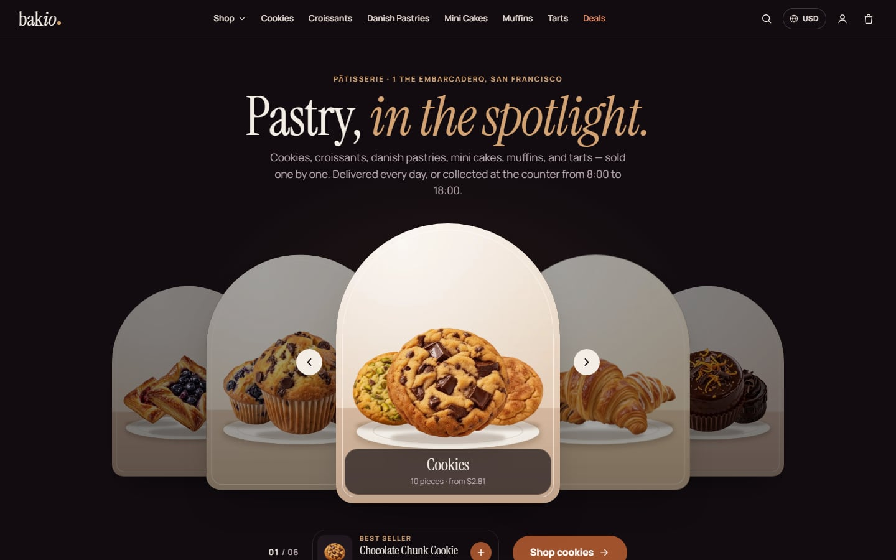 | 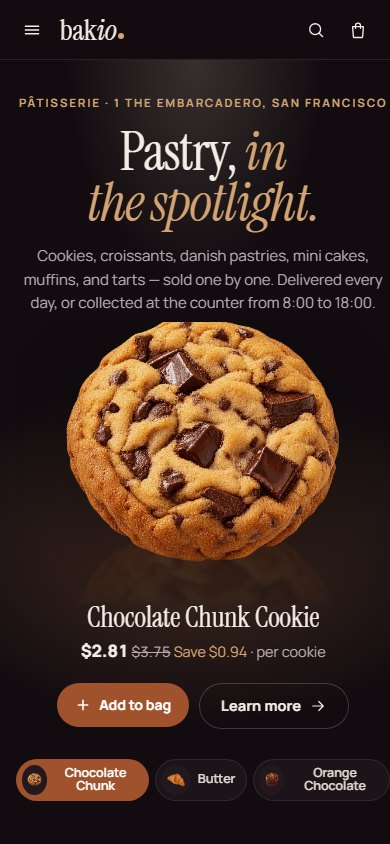 |
| 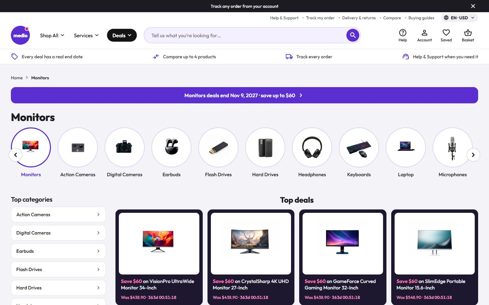 | 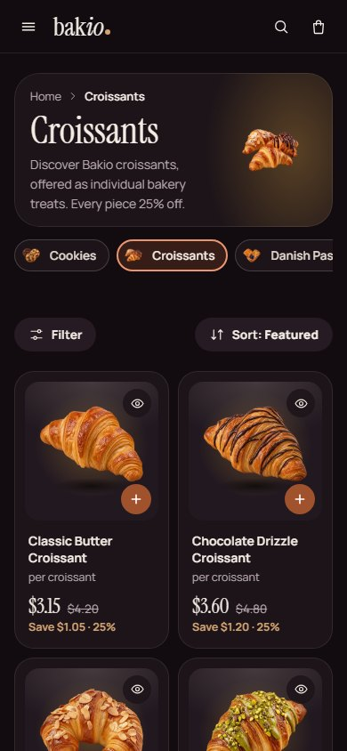 |
| 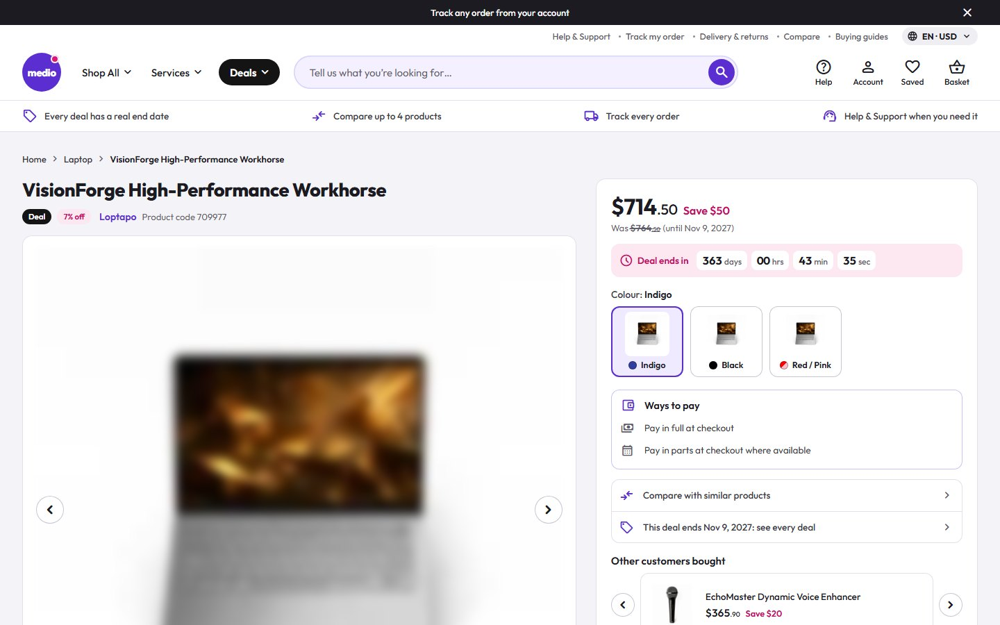 | 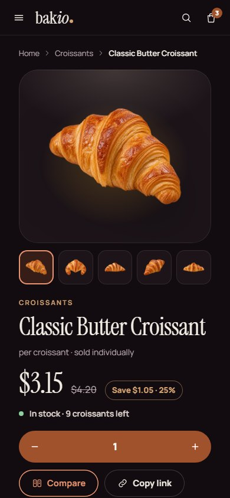 |
| 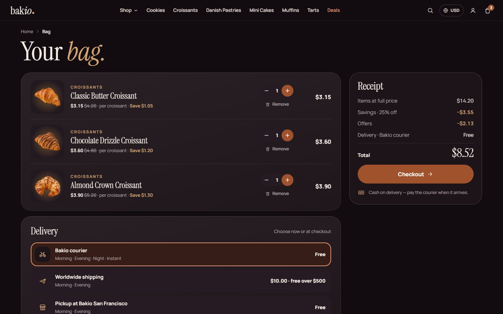 | 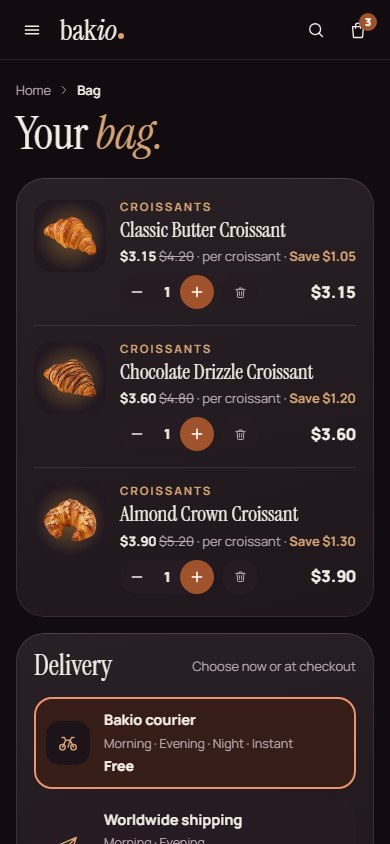 |

| Light mode (desktop) | Light mode (phone) | The Theme row (footer) |
| --- | --- | --- |
| 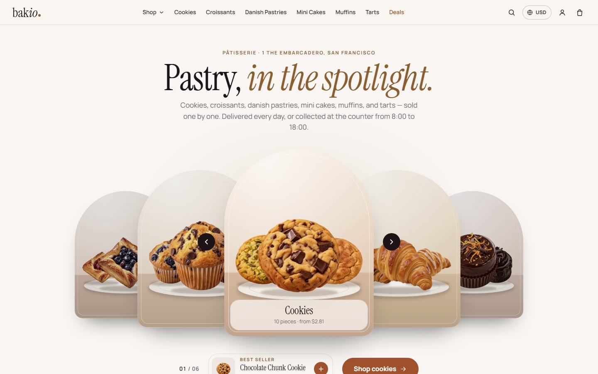 | 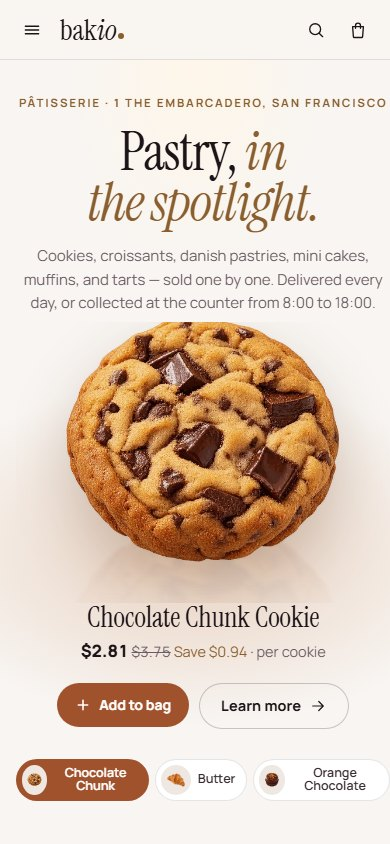 | 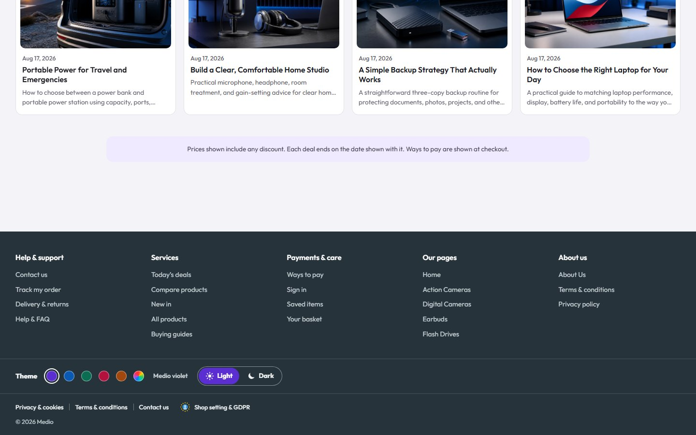 |

## Highlights

- **Header:** a slim glass bar that sticks to the top: the wordmark (the shop's title), **Shop** (every collection with its photo and line, plus Deals, Most loved, Compare and Journal), the collections on wide screens, Deals, a search with live suggestions and "popular" words, the language and currency pill, the account and the bag with its count. On a phone: the menu (collections, Deals, the bakery's pages, sign-in, a "Language & currency" sheet), search and the bag.
- **Home:** the stage (the best seller of each of the three best-selling collections, one tab each, no autoplay), the collections, Tonight's selection, a bento of the shop's real facts (open days and counter hours, the courier's windows, shipping and its free threshold, the way to pay, pickup), Most loved, **Which <unit> is yours?** (four best sellers side by side), a deals band with a Save roundel that fits any currency, Compose a trio, the bakery's story, **Visit & pickup** with a real map of the shop's address, and the journal (the four newest posts) last.
- **Listings:** a collection, a search, the deals and every pastry: real spec filters (a key becomes a filter only when it has two or more short values; no filter is invented), a price range, On offer and Sort, a calm loading fade, and a filter sheet on a phone.
- **Card:** the cut-out on its dark plate, a round **+** in the free corner that turns into "− n +" in place, a quick-look eye, the name, "per <unit>", the price, the struck was-price and the saving in gold.
- **Product page:** a gallery with one row of thumbnails, a sticky buy column (price, saving, stock, options only when the product has real variants, Add to bag, Compare, Copy link, delivery, pickup and payment lines) and a buy bar on a phone; **Why you'll love it** (the product's pros), the spec in the shop's groups, **Buy together**, the reviews (an honest empty state with the shop's rating criteria until the first review) and **More <collection>** without the product itself.
- **Compare and quick look:** the picks side by side with differences marked, in the theme colour; a quick look dialog (a bottom sheet on a phone).
- **Bag and checkout:** a bag drawer with "Often added" and a receipt, the bag page with a delivery preview, then the checkout: step pills, contact, delivery method cards with the shop's time windows (courier, worldwide shipping, pickup at the counter), an address sheet with or without a map, billing halves, a note for the bakery and Selldone's payment window. A shop without a payment method gets an honest "not taking payment right now" card instead of a dead button.
- **Orders and account:** the order page (receipt, delivery and a chat with the shop), the account as a desk (Overview, Orders, Addresses, Profile) and a sign-in sheet without Selldone branding.
- **Pages:** the journal and each article (a 720–760px column and a panel of the pastries the article links to, with **Add all**), About, Terms, Privacy and FAQ (sample text marked as such until the shop writes its own), Contact with the shop's real details, and a 404 inside the Layout.
- **Footer:** the wordmark and a line about the shop from its own data, the collections, the shop's footer menu, Help, **Visit the counter** (address, days and hours, phone, email), the Theme row and a legal row with Selldone's cookie settings.

## Tests

Every check runs one browser at a time against the live shop, at 1440px and 390px, dark and light, a custom yellow brand colour and Arabic (right to left). Each is delivered at **TOTAL 0**.

<!-- TESTS:START -->
<!-- TESTS:END -->

## Languages

Every word Bakini writes goes through `t("key", "English")` ([`components/kalio/i18n/`](components/kalio/i18n/)): the shared words in `base/<lang>.ts` and Bakini's own in `bakini.<lang>.ts`. Arabic loads only when a visitor picks it and turns the whole page right to left. To add a language, copy `bakini.en.ts` to `bakini.<code>.ts`, translate the values and register it in `index.ts`; the wiki page [Customize](https://github.com/selldone-custom-layouts/official-bakini/wiki/Customize) has the steps.

## Theme and colours

Bakini runs the shared theme switcher (`components/theme-switcher/`, the same code as the other custom Layouts). On your own shop the visitor switcher is hidden, and Bakini shows the theme you set in **one file**, [`components/bakini/bakini-theme.settings.ts`](components/bakini/bakini-theme.settings.ts): a palette (`caramel`, `cassis`, `pistachio`, `sapphire`, `gold`) or any brand colour (`brandColor: "#F5C400"`; a light colour keeps dark words on it with `textOnBrand: "auto"`), `dark` or `light`, and whether your visitors get the switcher (`themeSwitcher: "showcase" | "on" | "off"`). Every colour is made readable automatically. An AI agent finds the steps in the "Theme" section of [`AGENTS.md`](AGENTS.md); the wiki page [Theme and colours](https://github.com/selldone-custom-layouts/official-bakini/wiki/Theme-and-colours) has the details.

## Use it on your shop

| You want to… | Read |
| --- | --- |
| Let an AI agent (Claude Code, Codex…) set it up for your shop | [Install with AI](https://github.com/selldone-custom-layouts/official-bakini/wiki/Install-with-AI) |
| Do it yourself, step by step | [Manual Setup](https://github.com/selldone-custom-layouts/official-bakini/wiki/Manual-Setup) |
| Know what data your shop needs for the design to look right | [Shop Requirements](https://github.com/selldone-custom-layouts/official-bakini/wiki/Shop-Requirements) |
| Build, upload and verify a release | [Build and Upload](https://github.com/selldone-custom-layouts/official-bakini/wiki/Build-and-Upload) |
| Put the Layout live on your shop, or on one domain of it | [Go Live](https://github.com/selldone-custom-layouts/official-bakini/wiki/Go-Live) |
| Change the name, sections, pages or languages | [Customize](https://github.com/selldone-custom-layouts/official-bakini/wiki/Customize) |
| Change the colours, dark or light, the visitor switcher | [Theme and colours](https://github.com/selldone-custom-layouts/official-bakini/wiki/Theme-and-colours) |
| Fix a blank page, a rejected upload or an old version showing | [Troubleshooting](https://github.com/selldone-custom-layouts/official-bakini/wiki/Troubleshooting) |

The wiki's source is also in [`docs/wiki/`](docs/wiki/).

## Quick start (developers)

```bash
git clone https://github.com/selldone-custom-layouts/official-bakini.git
cd official-bakini
npm run setup            # the six Selldone modules (modules/)
for p in components translate; do git -C modules/$p apply ../../patches/modules-$p.kalio.patch; done
npm install --force
npm run serve            # dev server on http://localhost:9135, reading the shop named in .env
```

`.env` names the shop the dev server reads (`VITE_APP_SAMPLE_SHOP_NAME=bakio`). Releases:

```bash
LAYOUT_ID=<your Layout id> SELLDONE_CLI_SRC=<cli clone> bash scripts/release.sh <new version> desk
```

Leave `LAYOUT_ID` out on the first upload; use the id printed after it from then on. Never reuse a version number. See [Build and Upload](https://github.com/selldone-custom-layouts/official-bakini/wiki/Build-and-Upload).

## Where things are

| Area | Files |
| --- | --- |
| Your theme (palette, brand colour, mode, switcher) | [`components/bakini/bakini-theme.settings.ts`](components/bakini/bakini-theme.settings.ts) |
| Tokens for both modes (Noir and ivory) | [`style/bakini-theme.scss`](style/bakini-theme.scss) |
| The mockup's stylesheets, scoped to `.nx` (generated by [`scripts/noir-css.cjs`](scripts/noir-css.cjs)) | [`style/noir/`](style/noir/) |
| The Layout's own touches | [`style/bakini-noir.scss`](style/bakini-noir.scss), `style/bakini-noir-{shop,product,buy,read,account}.scss` |
| Shared data, layers, icons, card, quantity box, rows, bag drawer, quick look, map | [`components/bakini/noir/`](components/bakini/noir/) (`noir.ts`, `Nx*.vue`) |
| Home | [`components/bakini/noir/NxHome.vue`](components/bakini/noir/NxHome.vue) |
| Collections, search, deals (filters and sort) | [`components/bakini/noir/shop/NxListing.vue`](components/bakini/noir/shop/NxListing.vue), [`pages/products/`](pages/products/) |
| Product page and compare | [`components/bakini/noir/product/`](components/bakini/noir/product/), [`components/bakini/noir/compare/`](components/bakini/noir/compare/) |
| Bag, checkout, order, account | [`components/bakini/noir/buy/`](components/bakini/noir/buy/), [`components/bakini/noir/account/`](components/bakini/noir/account/), [`pages/basket/`](pages/basket/), [`pages/user/`](pages/user/) |
| Journal, article, About, Terms, Privacy, FAQ, Contact, 404, sign-in | [`components/bakini/noir/read/`](components/bakini/noir/read/), [`pages/blog/`](pages/blog/), [`pages/official/`](pages/official/), [`pages/faq/`](pages/faq/), [`pages/errors/`](pages/errors/) |
| Header and footer | [`components/bakini/shell/`](components/bakini/shell/) |
| The wordmark and the tab mark, from the shop's title; "bag" in Selldone's own strings | [`components/bakini/BakiniLogo.vue`](components/bakini/BakiniLogo.vue), [`components/kalio/kalio-brand.ts`](components/kalio/kalio-brand.ts) |
| Words and languages | [`components/kalio/i18n/`](components/kalio/i18n/) |
| Language and currency pill | [`components/region-switcher/`](components/region-switcher/) |
| How the mockup became the Layout, data rules and releases | [`BAKINI.md`](BAKINI.md) |
| The checks | [`scripts/run-checks.sh`](scripts/run-checks.sh) and the tools it names |
| Release tooling | [`scripts/`](scripts/) |
| Selldone storefront's original README | [`README.selldone.md`](README.selldone.md) |

Bakini started from [Medio Electronics](https://github.com/selldone-custom-layouts/official-medio) and keeps the shared parts of the earlier custom Layouts (the Kalio base: bag, checkout, account, compare; the theme and region switchers). Bakini's own markup lives in `.nx` wrappers with the mockup's class names.

## Credits and license

Built on the official [Selldone Storefront](https://github.com/selldone/storefront) (MIT License, © Selldone); see [`LICENSE.md`](LICENSE.md). Part of **[Selldone Custom Layouts](https://github.com/selldone-custom-layouts)**.
