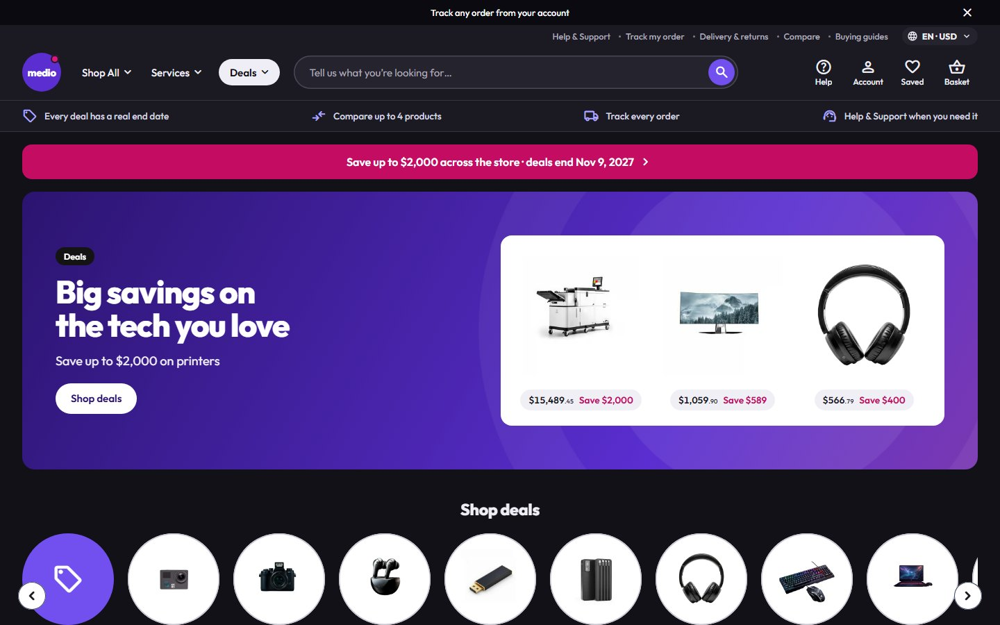
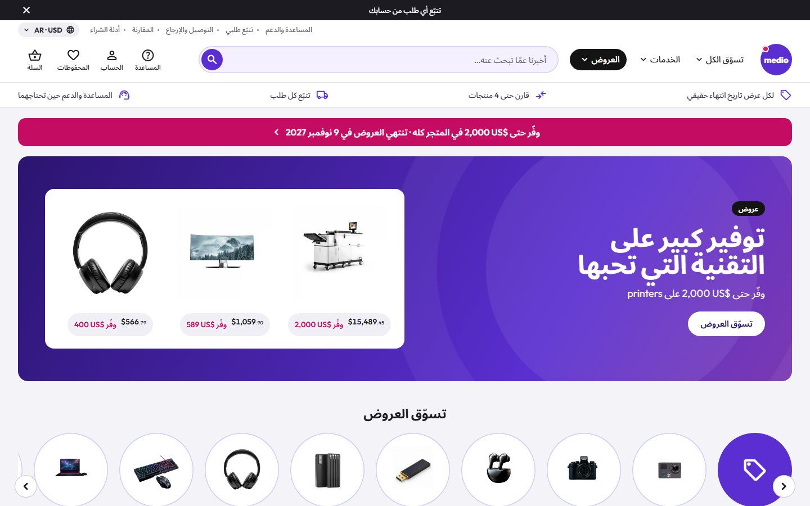

<p align="center">
  
</p>

<h1 align="center">Medio Electronics</h1>

<p align="center">
  <b>A big, friendly electronics retailer for a Selldone shop: deep violet, round, full of real deals.</b><br>
  A custom Selldone Layout built on the official <a href="https://github.com/selldone/storefront">selldone/storefront</a>.
</p>

<p align="center">
  <a href="https://medio.selldone.shop"></a>
  <a href="https://github.com/selldone-custom-layouts/official-medio/wiki"></a>
  <a href="https://github.com/selldone-custom-layouts/official-medio/wiki/Install-with-AI"></a>
  
  
  
</p>

<p align="center">
  <a href="https://medio.selldone.shop"><b>Open the live shop</b></a> ·
  <a href="https://github.com/selldone-custom-layouts/official-medio/wiki/Install-with-AI">Set it up with AI</a> ·
  <a href="https://github.com/selldone-custom-layouts/official-medio/wiki/Manual-Setup">Manual setup</a> ·
  <a href="https://github.com/selldone-custom-layouts/official-medio/wiki/Shop-Requirements">What your shop needs</a> ·
  <a href="https://github.com/selldone-custom-layouts">All Selldone custom layouts</a>
</p>

---

## What it is

**Medio Electronics** dresses a single-shop electronics store as a big high-street electronics retailer: a deals-first home, a category hub over every results page, a list view with a price column, and a product page with a sticky buy card. The page sections follow a big retailer's; the brand, words and photos are Medio's own.

- a light grey page (`#f4f3f7`) with white rounded cards (14px);
- **one** deep violet `#5a2ed0` for every action (pill buttons, the round search button, links, chosen states), hot magenta `#c40c63` for savings and the campaign strip, black pills for campaign tags, a dark slate footer;
- Outfit type and Material Symbols Rounded icons;
- flat buttons, hover changes the colour only, no line under any word or icon, selection rings inside the box;
- a **Theme** row in the footer on Medio's own showcase shop: five palettes (Medio violet, Ocean, Emerald, Ruby, Copper), a **Custom colour** and Light / Dark. One click changes the whole site, Selldone's own parts too, and the choice stays in the browser;
- every word Medio writes is translated: English, Arabic (right to left), Hindi and Danish, picked from the language and currency pill in the header.

It runs on **[medio.selldone.shop](https://medio.selldone.shop)**, one address of the Selldone shop Digini. Selldone lets each domain of a shop carry its own Layout.

Selldone's own cart, checkout, payments and orders keep working underneath. Nothing about the shop is hard-coded except the brand name (one line) and the photos: the category photos are matched by the category's slug, and the other photo slots show a named placeholder until their file is added.

## Screenshots

| Desktop | Phone |
| --- | --- |
|  |  |
|  |  |
|  |  |
|  |  |

| The Theme row (footer) | Dark mode | Arabic (right to left) |
| --- | --- | --- |
|  |  |  |

## Highlights

- **Header:** a dark strip with one honest message at a time (the deals' real end date, compare, track) and a close ×; a utility row (Help & Support, Track my order, Delivery & returns, Compare, Buying guides, the language and currency pill); the round violet logo, **Shop All** (every category on the left, the chosen one's top deals on the right), **Services**, a black **Deals** pill (every category with deals and its best saving); a big rounded search with a round violet button and suggestions; Help, Account, Saved and Basket (the basket's total as its label); four promises with line icons. On a phone: the logo with four icons, the search across, and a right-hand menu with All deals, six categories and "Show N more", the services and the language & currency row.
- **Home:** a magenta campaign strip, a violet hero with the three biggest deals, **Shop deals** round category tiles, promo tiles with the owner's category photos, **The latest from <brand>**, **Deals from our top brands**, dark **Deals** cards with each deal's own clock, Best sellers / Just arrived / Popular picks tabs (one tab per tag), **Discover our amazing offers**, **Why shop with Medio** (six pastel tiles, each a real page) and the newest buying guides.
- **Category hub** over every results page: breadcrumb, a violet campaign strip, the name, a round category carousel; Top categories, Popular links and Buying guides on the left; Top deals, **Can't decide?** (one choice per tag in the category), guide cards and the category's brands on the right.
- **Results page:** a Filters card on the left (Hide out of stock, Deals, price boxes and ranges, Brand, Colour, capacity and the category's spec filters, "Show N more"; a side sheet on a phone), a toolbar (Sort by, Show 20 / 40 / 60, the count, **List / Grid**). The list row: the picture; the name, six bullets from the product's own spec and an offer box; a price column with Save, Was, In stock, the shop's own delivery ways, View product and Add to basket.
- **Card:** white and rounded: small badges (Deal, New, Best seller), a two-line name, the price with a magenta "Save $X", "Was", the deal's clock, swatches or capacity chips, a violet pill **Add to basket** that turns into "− n +" in place, Compare and Save.
- **Product page:** the name, badges, brand and code; the gallery card and a key-spec grid; a sticky buy card on the right (price, Save, Was until the deal's end, the clock, colour or capacity tiles, Ways to pay, offer rows, stock, Other customers bought, Add to basket, Save for later, Share, delivery and help rows); **What you'll need to make it even better** (three real products with tick boxes); a top bar on a computer and a buy bar on a phone once the button scrolls away; **Buy together and save**, accordions (Product information, Specifications, Reviews, Delivery & returns), **We recommend** and **More like this**.
- **Basket and checkout:** a basket drawer (subtotal, savings, Checkout, compact rows, "Often added"), a numbered basket page, a map-first address sheet, the delivery method and the payment window.
- **Orders and account:** receipt, delivery and messages; the account as a **desk** (side menu, order cards, address book).
- **Pages:** Help & Support (topic tiles and the shop's questions), a designed 404 with round category tiles and today's deals, compare, guides and articles, About, Terms, Privacy (sample text marked as such until the shop writes its own) and Contact us with a form.
- **Footer:** dark slate columns (Help & support, Services, Payments & care, Our pages, About us), the Theme strip, and a legal row with Selldone's cookie settings and the shop's social links.

## Languages

Every word Medio writes goes through `t("key", "English")` ([`components/kalio/i18n/`](components/kalio/i18n/)): the shared Kalio words in `base/<lang>.ts` and Medio's own in `medio.<lang>.ts`. Arabic, Hindi and Danish load only when a visitor picks them; Arabic turns the whole page right to left. To add a language, copy `medio.en.ts` to `medio.<code>.ts`, translate the values and add it to `index.ts`; the wiki page [Customize](https://github.com/selldone-custom-layouts/official-medio/wiki/Customize) has the steps.

## Theme and colours

Medio runs the shared theme switcher (`components/theme-switcher/`, the same code as the other custom Layouts). On your own shop the visitor switcher is hidden, and Medio shows the theme you set in **one file**, [`components/medio/medio-theme.settings.ts`](components/medio/medio-theme.settings.ts): a palette (`medio`, `ocean`, `emerald`, `ruby`, `copper`) or any brand colour (`brandColor: "#F5C400"`; a light colour keeps dark words on it with `textOnBrand: "auto"`), `light` or `dark`, and whether your visitors get the switcher (`themeSwitcher: "showcase" | "on" | "off"`). Every colour is made readable automatically. An AI agent finds the steps in the "Theme" section of [`AGENTS.md`](AGENTS.md); the wiki page [Theme and colours](https://github.com/selldone-custom-layouts/official-medio/wiki/Theme-and-colours) has the details.

## Use it on your shop

| You want to… | Read |
| --- | --- |
| Let an AI agent (Claude Code, Codex…) set it up for your shop | [Install with AI](https://github.com/selldone-custom-layouts/official-medio/wiki/Install-with-AI) |
| Do it yourself, step by step | [Manual Setup](https://github.com/selldone-custom-layouts/official-medio/wiki/Manual-Setup) |
| Know what data your shop needs for the design to look right | [Shop Requirements](https://github.com/selldone-custom-layouts/official-medio/wiki/Shop-Requirements) |
| Build, upload and verify a release | [Build and Upload](https://github.com/selldone-custom-layouts/official-medio/wiki/Build-and-Upload) |
| Put the Layout live on your shop, or on one domain of it | [Go Live](https://github.com/selldone-custom-layouts/official-medio/wiki/Go-Live) |
| Change the name, photos, sections, pages or languages | [Customize](https://github.com/selldone-custom-layouts/official-medio/wiki/Customize) |
| Change the colours, light or dark, the visitor switcher | [Theme and colours](https://github.com/selldone-custom-layouts/official-medio/wiki/Theme-and-colours) |
| Fix a blank page, a rejected upload or an old version showing | [Troubleshooting](https://github.com/selldone-custom-layouts/official-medio/wiki/Troubleshooting) |

The wiki's source is also in [`docs/wiki/`](docs/wiki/).

## Quick start (developers)

```bash
git clone --recurse-submodules https://github.com/selldone-custom-layouts/official-medio.git
cd official-medio
npm install --force
npm run serve            # dev server on http://localhost:9134
```

Releases:

```bash
LAYOUT_ID=<your Layout id> SELLDONE_CLI_SRC=<cli clone> bash scripts/release.sh <new version> desk
```

Leave `LAYOUT_ID` out on the first upload; use the id printed after it from then on. See [Build and Upload](https://github.com/selldone-custom-layouts/official-medio/wiki/Build-and-Upload).

## Where things are

| Area | Files |
| --- | --- |
| The brand name (one line) and the mark | [`components/kalio/kalio-brand.ts`](components/kalio/kalio-brand.ts), [`assets/brand/medio-mark.svg`](assets/brand/medio-mark.svg), [`components/medio/MedioLogo.vue`](components/medio/MedioLogo.vue) |
| Your theme (palette, brand colour, mode, switcher) | [`components/medio/medio-theme.settings.ts`](components/medio/medio-theme.settings.ts) |
| Header and footer | [`components/medio/shell/`](components/medio/shell/) |
| Home, card, rails | [`components/medio/`](components/medio/) (`MedioHome.vue`, `MedioCard.vue`, `MedioRail.vue`, `medio-buy.ts`, `medio.ts`) |
| Category hub and filters | [`components/medio/shop/`](components/medio/shop/), [`pages/products/`](pages/products/) |
| Product page | [`components/medio/product/`](components/medio/product/), [`pages/product/`](pages/product/) |
| Words and languages | [`components/kalio/i18n/`](components/kalio/i18n/) |
| Photo slots and their files | [`components/medio/medio-photos.ts`](components/medio/medio-photos.ts), [`assets/photos/`](assets/photos/) |
| Category photos (by category slug) | [`assets/medio/`](assets/medio/) |
| Medio's colour tokens and dress | [`style/medio-theme.scss`](style/medio-theme.scss), [`style/medio.scss`](style/medio.scss), [`style/medio-home.scss`](style/medio-home.scss), [`style/medio-shop.scss`](style/medio-shop.scss), [`style/medio-pdp.scss`](style/medio-pdp.scss) |
| What Medio is, its data rules and releases | [`MEDIO.md`](MEDIO.md) |
| The behaviours it keeps (basket, checkout, account…) | [`components/kalio/`](components/kalio/), [`KALIO.md`](KALIO.md) |
| Release tooling | [`scripts/`](scripts/) |
| Selldone storefront's original README | [`README.selldone.md`](README.selldone.md) |

Medio started from [Argon Electronics](https://github.com/selldone-custom-layouts/official-argon) and keeps its shared parts (classes `k-`, `t-`, `w-`, the theme switcher, the region switcher, the compare page, the basket drawer, the desk account). Medio's own classes are `md-`.

## Credits and license

Built on the official [Selldone Storefront](https://github.com/selldone/storefront) (MIT License, © Selldone); see [`LICENSE.md`](LICENSE.md). Part of **[Selldone Custom Layouts](https://github.com/selldone-custom-layouts)**.
