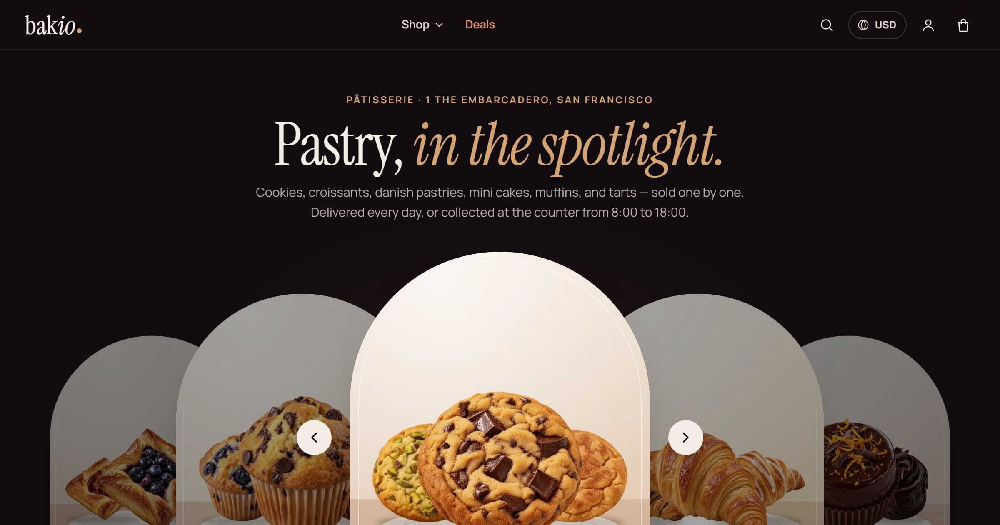
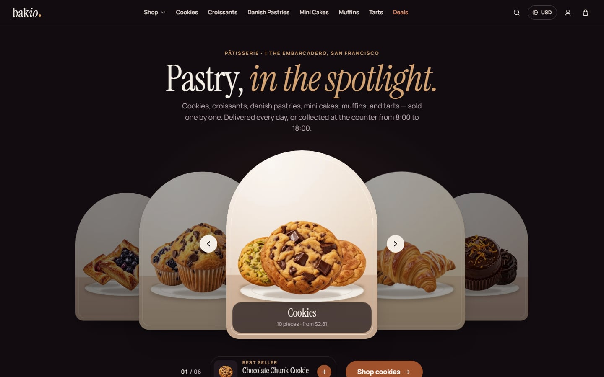
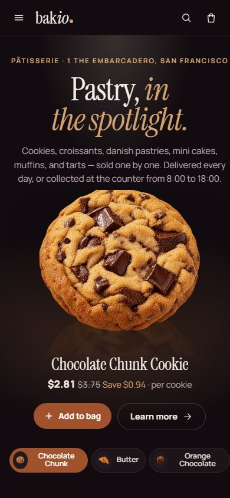
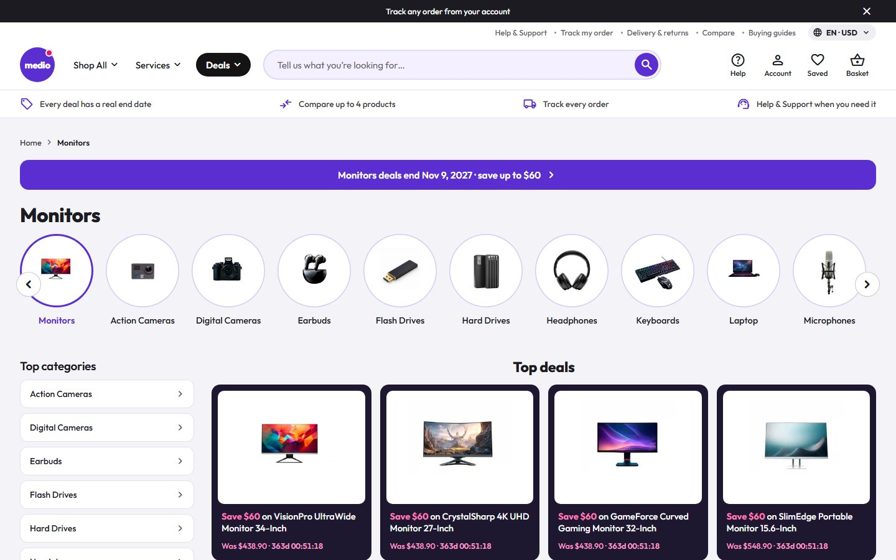
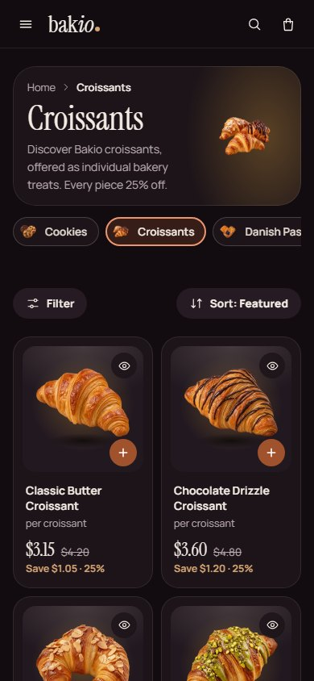
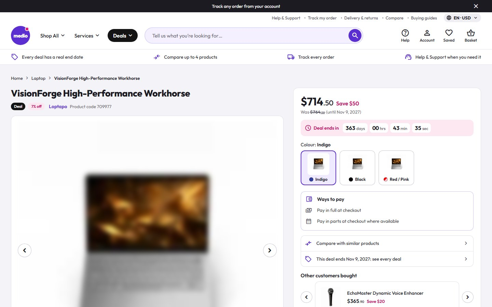
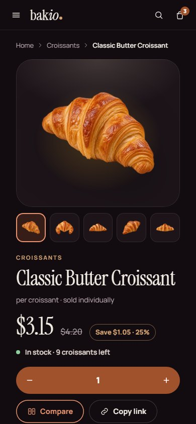
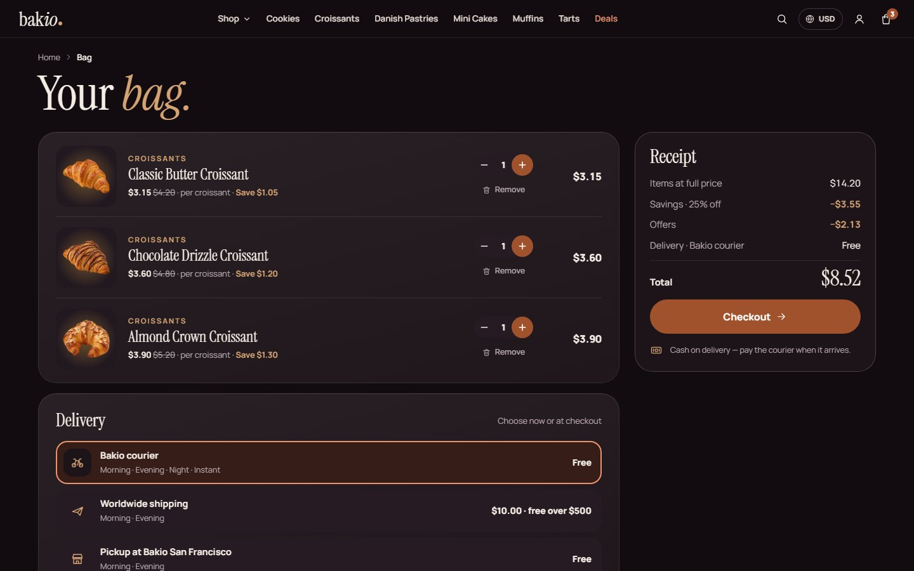
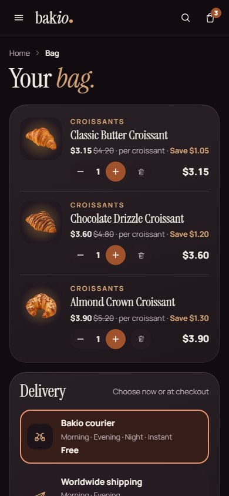

# Bakini Noir Patisserie

**Bakini Noir Patisserie** is a custom storefront **Layout** for Selldone shops: a single bakery dressed as a dark pastry theatre. A deep stage with ivory type, one deep caramel for every action, gold for small accents and hairlines, Instrument Serif over Manrope, and every pastry a cut-out floating on a dark plate under a warm halo. A stage hero, the collections as tall dark cards, a bento of the shop's real facts, a compare strip and a deals band; real spec filters; a product page with a sticky buy column and Buy together; a bag drawer, glass checkout cards, a desk account and a 404 inside the Layout. Dark is the default, with an ivory light mode. It says **bag**, never cart. Every word it writes is in English and Arabic (right to left).

It runs on **[bakini.selldone.shop](https://bakini.selldone.shop)**, one address of the Selldone shop Bakio: one shop, one Layout per domain (see [Go Live](Go-Live)). It is built on the official [selldone/storefront](https://github.com/selldone/storefront), so Selldone's basket, checkout, payments and orders keep working underneath a new design.

## Start here

| I want to… | Page |
| --- | --- |
| Have an AI agent set it up on my shop | **[Install with AI](Install-with-AI)** |
| Set it up myself | [Manual Setup](Manual-Setup) |
| Know what my shop's data needs | [Shop Requirements](Shop-Requirements) |
| Build, upload and verify a release | [Build and Upload](Build-and-Upload) |
| Put it live on my shop or one domain | [Go Live](Go-Live) |
| Change the name, sections, pages, languages | [Customize](Customize) |
| Change the colours, dark or light, the visitor switcher | [Theme and colours](Theme-and-colours) |
| Fix a problem | [Troubleshooting](Troubleshooting) |

## How a Selldone Layout works (one minute)

1. A **Layout** is a complete storefront app (Vue 3) that runs on Selldone's own servers instead of the default storefront.
2. You build it, zip it, and **upload** it to your Selldone developer account with the official [selldone-cli](https://github.com/selldone/cli). Each upload is a new **version**.
3. You **attach** a version to your shop, or to one domain of it.
4. Selldone injects **your** shop into the Layout: its title, collections, products, prices, delivery ways, payment methods, articles, languages, currencies and settings. Nothing about Bakio is hard-coded: not the name (the wordmark is your shop's title), not a photo (every picture is your shop's own), not a delivery window or an opening hour. Another bakery that imports the Layout gets its own data.

## The look

| Part | Bakini |
| --- | --- |
| Action colour | one deep caramel `#a0522d` (white words 5.62:1): every button, chosen states, links |
| Accents | gold `#d4a373` (`#8a5e2e` in light mode) for small type, savings and hairlines only |
| Grounds | the dark stage `#120c10`, cards `#1c1419` and `#261b22`, ivory words `#f4ede6`; each collection gets a warm hue for its halo, in the shop's order |
| Pastries | transparent cut-outs on dark plates under a warm halo, a soft shadow beneath |
| Type and icons | Instrument Serif (display, italic accents) over Manrope (text); inline line icons |
| Buttons | flat; hover changes the colour only; no line under any word or icon; selection rings inside the box |
| Theme | dark by default, an ivory light mode; five palettes and a custom colour; a visitor switcher (a footer row) on Bakini's showcase shop only (see [Theme and colours](Theme-and-colours)) |
| Languages | English and Arabic (right to left); the language and currency pill in the header |

## What you get

- **Header:** a slim glass bar that sticks to the top. The wordmark (your shop's title); "Shop" (a panel with every collection, its photo and line, plus Deals, Most loved, Compare and Journal); the collections themselves on wide screens; Deals; search with live suggestions; the language and currency pill; the account; the bag with its count. On a phone: the menu button, the wordmark, search and the bag; the menu lists the collections, Deals, the bakery's pages, the account and a "Language & currency" row that opens a bottom sheet.
- **Footer:** the wordmark and one line about the shop from its own data, the collections, your footer menu, Help, "Visit the counter" (address, days and counter hours, phone, email), the Theme row (showcase only) and the legal row.
- **Home:** the stage (the best seller of each of the three best-selling collections, one pastry huge under a spotlight, one tab each); Explore the collections; Tonight's selection; a bento of the shop's real facts (open days and counter hours, the courier's windows, shipping and its free threshold, the way to pay, pickup); Most loved; "Which <unit> is yours?" (the top collection's four best sellers side by side); a deals band with a Save roundel; Compose a trio; the bakery's story; Visit & pickup with a real map; the journal (the four newest posts) last.
- **Listings:** a collection, a search, the deals and every pastry. Real spec filters, a price range, On offer and Sort; on a phone a Filter button opens the panel as a sheet.
- **Cards:** the cut-out on its plate, a round + that turns into "− n +" in place, a quick-look eye, the name, "per <unit>", the price with the struck was-price and the saving in gold.
- **Product page:** the gallery and a sticky buy column (price, saving, stock, options when the product has them, "Add to bag", Compare, Copy link, delivery, pickup and payment lines); a phone buy bar; Why you'll love it (the product's pros); Product information (the spec in your groups); Buy together; the reviews (an honest empty state with your rating criteria until the first review); More <collection>.
- **Compare and quick look:** the picks side by side with differences marked; a quick look dialog (a bottom sheet on a phone).
- **Bag and checkout:** a bag drawer with "Often added", the bag page, then the checkout: step pills, contact, delivery method cards with your time windows, an address sheet (with or without a map), billing, a note and Selldone's payment window. Without a payment method it says plainly that the shop is not taking payment.
- **Orders and account:** the order page (receipt, delivery and a chat with the shop); the account as a desk (Overview, Orders, Addresses, Profile) where each order shows its steps (Placed, Baking, On the way, Delivered); a sign-in sheet.
- **Content pages:** the journal and each story (a panel with the pastries the story links to and "Add all"), About, Terms, Privacy, FAQ, Contact and a 404 inside the Layout.

## Screens

| Desktop | Phone |
| --- | --- |
|  |  |
|  |  |
|  |  |
|  |  |

## Links

- Live shop: <https://bakini.selldone.shop>
- Repository: <https://github.com/selldone-custom-layouts/official-bakini>
- What Bakini is, how the pages were built and its releases: [`BAKINI.md`](https://github.com/selldone-custom-layouts/official-bakini/blob/main/BAKINI.md); shared behaviours: [`KALIO.md`](https://github.com/selldone-custom-layouts/official-bakini/blob/main/KALIO.md)
- All official custom Layouts: <https://github.com/selldone-custom-layouts>
- Selldone: <https://selldone.com>
