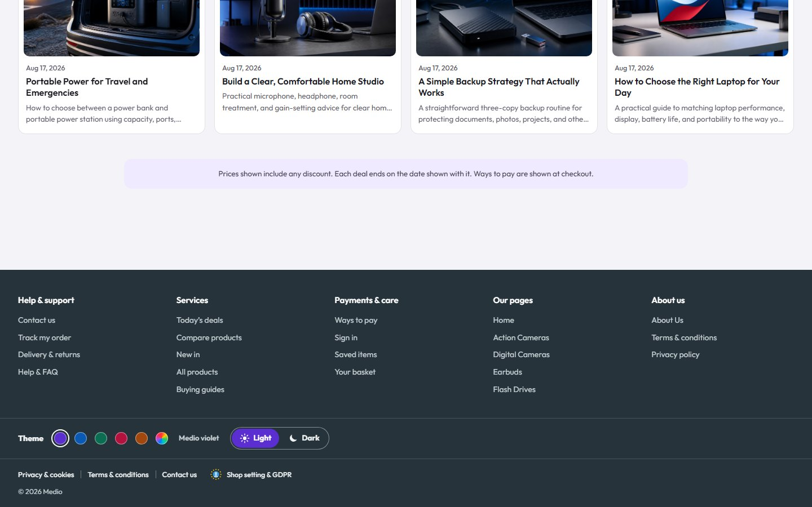
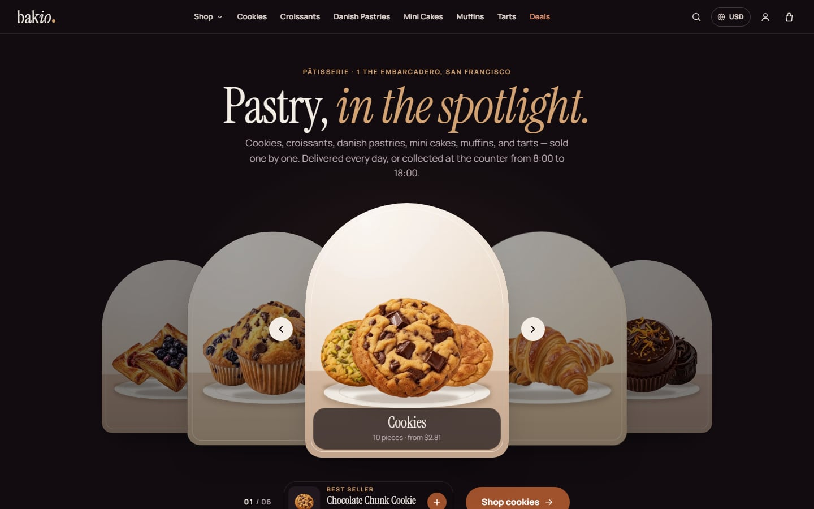
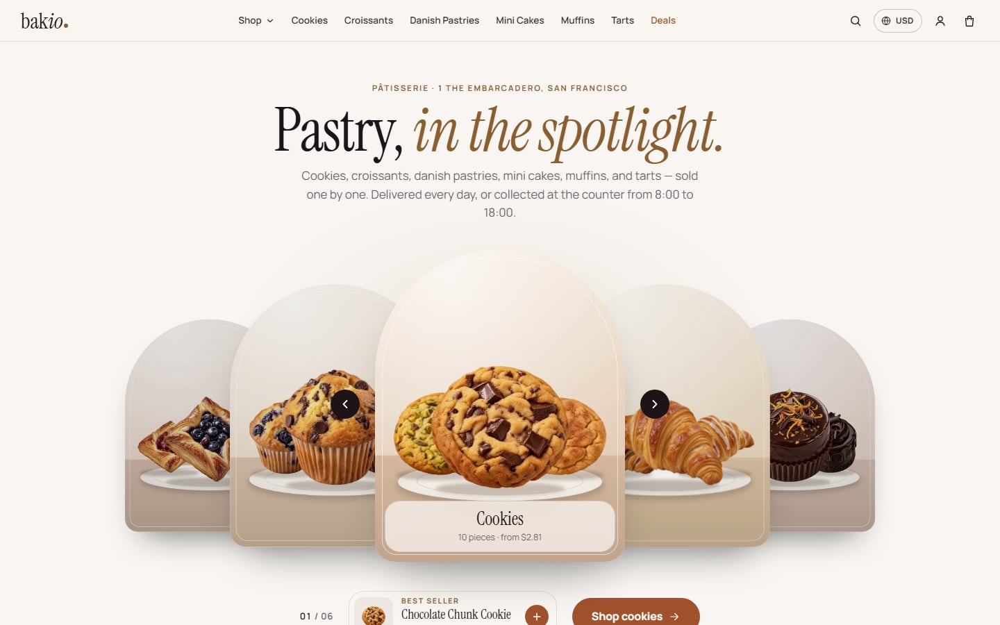
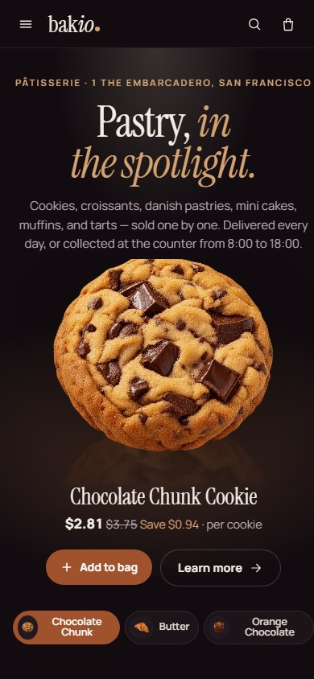
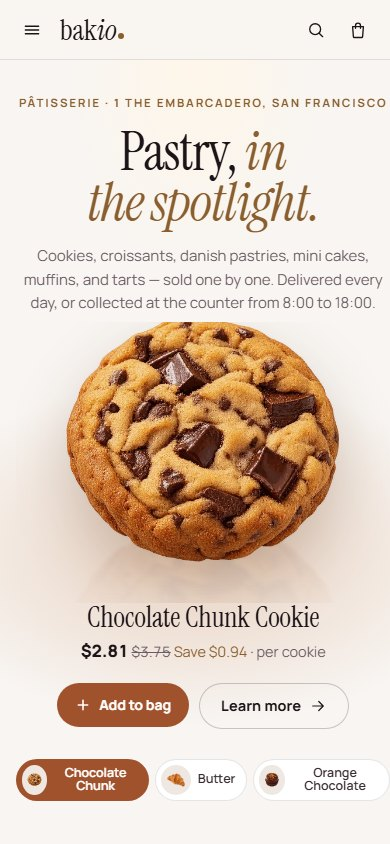

# Theme and colours

Bakini runs the **shared theme switcher** (`components/theme-switcher/`), the same code as the other custom Layouts. Bakini's palettes are in `components/bakini/bakini-theme.ts` and its grounds, lines and words for both modes in `style/bakini-theme.scss`; the **one file a merchant edits** is `components/bakini/bakini-theme.settings.ts`.

## Bakini's colours

Bakini paints every action with **one colour**, deep caramel `#a0522d` (white words 5.62:1): every button, chosen states and links.

Around it, in the dark mode (the default): the stage `#120c10`, cards `#1c1419` and raised parts `#261b22`, ivory words `#f4ede6`, muted words `#b8a9af`, and gold `#d4a373` for small type, savings and hairlines only, in every palette. Each collection gets one of six warm hues for the halo behind its pastries. In the ivory light mode: the page `#f8f5f2`, white cards, ink `#1d1418` and a darker gold `#8a5e2e`. Every colour is a token in `style/bakini-theme.scss` (`:root` is light, `html.bk-dark` is dark).

Dark is painted before the first paint on every shop, so the ivory version never flashes.

## On Bakini's showcase shop



The **Theme** row sits in the footer, in a band of its own above the legal row. It is never in the header. It holds:

- **Colour:** Caramel (the default), Cassis, Pistachio, Sapphire, Gold-safe, and **Custom colour** (any colour from the browser's colour picker; it is made readable in dark and light against Noir's own surfaces, with a note "Adjusted for readability" when it had to change).
- **Mode:** Light or Dark.

One click changes the whole site at once, with no reload: Bakini's colours, the Kalio base, Vuetify's theme and Selldone's own parts (the buy button, prices, the bag drawer, the checkout sheets, dialogs). The choice is kept in the browser (key `bakini-theme`; dark mode is the class `bk-dark` on `<html>`) and painted before the first paint, so the default never flashes. The arrow keys (and Home / End) move between the swatches.

| Dark (the default) | Light |
| --- | --- |
|  |  |
|  |  |

## On your own shop

The visitor switcher is a **showcase** feature. With `themeSwitcher: "showcase"` it shows only on the Layout's own showcase shops (listed in `showcaseShops` in `components/bakini/bakini-theme.ts`). On any other shop it is not shown, nothing is read from or written to the browser's storage, and Bakini shows the theme from the settings file:

```ts
export const THEME_SETTINGS: ThemeSettings = {
  palette: "caramel",        // "caramel" | "cassis" | "pistachio" | "sapphire" | "gold"
  // brandColor: "#F5C400",  // any colour; replaces palette
  mode: "dark",              // "dark" | "light"
  themeSwitcher: "showcase", // "showcase" | "on" (your visitors get it) | "off"
  textOnBrand: "auto",       // with brandColor: "auto" (a light brand keeps dark words) | "white"
};
```

| Setting | Allowed values |
| --- | --- |
| `palette` | `"caramel"` (the brand; the default), `"cassis"`, `"pistachio"`, `"sapphire"`, `"gold"` (Gold-safe) |
| `brandColor` | any `"#RRGGBB"`; when set it replaces `palette` |
| `mode` | `"dark"` (the Noir stage; the default) or `"light"` (the ivory version) |
| `themeSwitcher` | `"showcase"` (the visitor switcher shows only on the Layout's own showcase shops; the default), `"on"` (your visitors get the Theme row in the footer), `"off"` |
| `textOnBrand` | only with `brandColor`: `"auto"` (a light brand such as yellow keeps its colour, with dark words on it) or `"white"` (white words; a light colour is darkened) |

Every colour is made readable automatically: buttons, links, chosen states and dark mode.

## Examples

Change only these lines; leave the rest of the file as it is.

| You want | Set |
| --- | --- |
| "Use the yellow theme" | No palette is yellow, so use a brand colour: `brandColor: "#F5C400", textOnBrand: "auto"` |
| "My brand colour is #F5C400" | `brandColor: "#F5C400", textOnBrand: "auto"`; use `textOnBrand: "white"` for white words (the colour is then darkened) |
| "Make it light" | `mode: "light"` |
| "Let visitors switch themes" | `themeSwitcher: "on"` |
| "Remove the switcher" | `themeSwitcher: "off"` (on your own shop it is already hidden with `"showcase"`) |
| "Go back to the original colours" | remove `brandColor`, set `palette: "caramel", mode: "dark"` |

Then build and upload a new version and put it live:

```bash
LAYOUT_ID=<your Layout id> SELLDONE_CLI_SRC=<cli clone> bash scripts/release.sh <new version> desk
```

See [Build and Upload](Build-and-Upload) and [Go Live](Go-Live).

## Contrast

| Palette | White words on the action colour (light) |
| --- | --- |
| Caramel | `#a0522d` 5.62:1 |
| Cassis | `#8e2f55` 7.81:1 |
| Pistachio | `#477526` 5.47:1 |
| Sapphire | `#2f5fb3` 6.16:1 |
| Gold-safe | `#8c5f30` 5.53:1 |

In dark mode, white words on every palette's action colour read at 5.19:1 or more, each action colour stands at 3.2:1 or more against the dark card `#1c1419`, and every palette's text colour reads at 7.15:1 or more on the raised surface `#261b22` (Caramel's is `#ea9570`). Gold reads at 7.98:1 and muted words at 8.02:1 on a dark card; in light mode gold reads at 5.20:1 and muted words at 5.80:1 on the page. A custom or brand colour goes through `paletteFromColor()`, which moves only its lightness until each role reads against Noir's surfaces. The pastry plates are tokens too: dark in dark mode, ivory in light mode.

## Checks

Run these from the repository root after a theme change. They need Playwright; set `PW` to your install (`PW=<path>/node_modules/playwright`) if the default path is not yours. `".ftr"` is the footer, which every page shows once it is ready.

1. **Contrast** on the live shop, at desktop and phone width. It must print `TOTAL 0`:
   ```sh
   PAGES="home=/,category=/<a category>,product=/product/<id>" \
     node components/theme-switcher/tools/contrast-audit.cjs https://<your shop> ".ftr"
   ```
   To test one palette and mode, add `STORAGE='{"bakini-theme":"{\"palette\":\"caramel\",\"mode\":\"light\"}"}'` (this works where the switcher is shown).
2. **Bag drawer, bag page and address sheet.** It must print `TOTAL 0`. It fills a bag in the browser only and blocks every order request. The palette argument is a palette id, or `custom:#rrggbb` for a custom colour:
   ```sh
   SHOP=<your shop's xapi name> STORAGE_KEY=bakini-theme WAIT=".ftr" CART=".bag-btn" \
     node components/theme-switcher/tools/cart-audit.cjs https://<your shop> caramel dark
   ```
3. **Underlines and boxes.** No line under any word or icon, at rest or on hover; photos never on words, icon rows aligned. Each must print `TOTAL 0`:
   ```sh
   PAGES="home=/,category=/<a category>,product=/product/<id>" node scripts/underline-check.cjs https://<your shop> ".ftr"
   SHOP=<your shop's xapi name> PAGES="home=/,category=/<a category>,product=/product/<id>" \
     node scripts/box-check.cjs https://<your shop> ".ftr"
   ```
   Both default to the showcase shop's pages, so always pass `PAGES` (and `SHOP` for the box check, which also opens the menus, a quick look and the bag).
4. **Colour maths:** `node components/theme-switcher/theme-color.test.mjs` (Node 22.6 or newer).

On Bakini's showcase shop the same checks run with `https://bakini.selldone.shop`, `SHOP=bakio`, `PAGES="home=/,category=/croissants-category,product=/product/720375"`, for each palette in dark and light.
